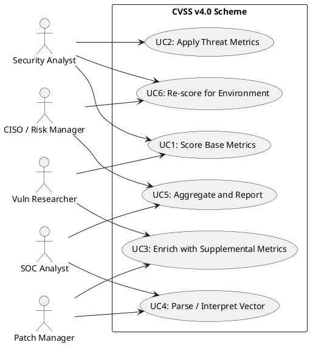
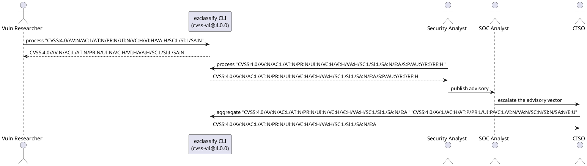

# CVSS v4.0 Actors & Use Cases

## Actors

| Actor                    | Role                                                                                                     | Day-to-Day Context                                                                                            |
| ------------------------ | -------------------------------------------------------------------------------------------------------- | ------------------------------------------------------------------------------------------------------------- |
| Security Analyst         | Scores vulnerabilities using the expanded v4.0 metric groups, produces CVSS-B/BT/BE/BTE vectors          | Works in a PSIRT or vulnerability management team; authors advisories using the new v4.0 nomenclature         |
| Vulnerability Researcher | Identifies new vulnerabilities and evaluates both vulnerable-system and subsequent-system impacts        | Performs technical analysis, determines whether exploitation is automatable, and assesses recovery difficulty |
| SOC Analyst              | Consumes CVSS v4.0 scores from threat intel feeds, uses Supplemental metrics for prioritization          | Monitors alerts, correlates exploit maturity with asset criticality, and escalates based on provider urgency  |
| CISO / Risk Manager      | Uses severity ratings and Supplemental context (safety, value density) to prioritize remediation budgets | Reviews risk dashboards, communicates exposure in business terms, and tracks remediation SLAs                 |
| Patch Manager            | Prioritizes patching using the response effort and provider urgency Supplemental metrics                 | Schedules maintenance windows, coordinates with asset owners, and validates fixes through rescanning          |

## Use-Case Diagram (Text UML)

## Use Cases

### UC1: Score Base Metrics

**Actor(s):** Security Analyst, Vulnerability Researcher
**Preconditions:** A vulnerability has been technically analyzed and its attack characteristics are known.
**Flow:**

1. The analyst selects Attack Vector (AV), Attack Complexity (AC), Attack Requirements (AT), Privileges Required (PR), and User Interaction (UI).
2. The analyst selects Vulnerable System impacts: VC, VI, VA (Confidentiality, Integrity, Availability).
3. The analyst selects Subsequent System impacts: SC, SI, SA.
4. The system validates that exactly one value is selected per metric.
5. The system renders the CVSS-B vector string.
   **Postconditions:** The vulnerability carries a validated CVSS v4.0 Base vector with both vulnerable and subsequent system impacts.

### UC2: Apply Threat Metrics

**Actor(s):** Security Analyst
**Preconditions:** A Base vector exists and exploit maturity information is available.
**Flow:**

1. The analyst selects the Exploit Maturity (E) value: Attacked, POC, or Unreported.
2. The system appends the Threat metric to produce a CVSS-BT vector.
3. The vector records whether active exploitation is occurring. A separate CVSS calculator can score the completed vector.
   **Postconditions:** The vector string includes Threat context for an external CVSS-BT calculation. This scheme does not compute the numeric score.

### UC3: Enrich with Supplemental Metrics

**Actor(s):** Vulnerability Researcher, Patch Manager
**Preconditions:** A Base or BT vector exists and additional context is available.
**Flow:**

1. The actor selects applicable Supplemental metrics: Safety (S), Automatable (AU), Recovery (R), Value Density (V), Response Effort (RE), Provider Urgency (U).
2. The system appends Supplemental metrics to the vector.
3. The enriched vector provides context for prioritization without changing the numeric score.
   **Postconditions:** The vector carries Supplemental context that aids downstream prioritization decisions.

### UC4: Parse / Interpret Vector

**Actor(s):** SOC Analyst, Patch Manager
**Preconditions:** A CVSS v4.0 vector string has been received from a feed or advisory.
**Flow:**

1. The actor inputs the vector string.
2. The system tokenizes on "/" separators and maps each metric:value pair to the corresponding concept.
3. The system displays the human-readable metric breakdown. A severity rating (None, Low, Medium, High, Critical) comes from the CVSS score, which this scheme does not compute; when one is supplied, the `severity` format renders it.
4. The actor uses Supplemental metrics (e.g., Automatable: Yes, Recovery: Irrecoverable) to refine response priority.
   **Postconditions:** The actor understands the full vulnerability context including exploitability, impact, threat status, and supplemental factors.

### UC5: Aggregate and Report

**Actor(s):** SOC Analyst, CISO / Risk Manager
**Preconditions:** Multiple vulnerabilities have been scored for assets within a system boundary.
**Flow:**

1. The system collects all CVSS v4.0 markings for the target scope.
2. Aggregation applies the "max" operator per metric category, producing the worst-case vector.
3. The worst-case vector is displayed on executive dashboards.
   **Postconditions:** Leadership has a single worst-case CVSS v4.0 vector for the system under review.

### UC6: Re-score for a Deployment Environment (CVSS-BE / CVSS-BTE)

**Actor(s):** Security Analyst, CISO / Risk Manager
**Preconditions:** A Base (or BT) vector exists and the analyst knows how the vulnerable system is actually deployed and how critical its data is.
**Flow:**

1. The analyst sets Security Requirements (CR, IR, AR) to reflect how critical confidentiality, integrity, and availability are for the affected asset.
2. Where the deployment differs from the reasonable-worst-case Base assumptions, the analyst overrides the corresponding Modified Base metrics (MAV, MAC, MAT, MPR, MUI, MVC, MVI, MVA, MSC, MSI, MSA).
3. For subsequent-system integrity or availability that could cause physical harm, the analyst may set MSI or MSA to Safety (S).
4. The system validates one value per metric. A separate CVSS calculator resolves Modified Base metrics left at Not Defined (X) against their Base counterpart.
5. The system renders a CVSS-BE vector (Base + Environmental) or, with Threat metrics present, a CVSS-BTE vector (Base + Threat + Environmental). Supplemental metrics may accompany either vector without changing its scoring nomenclature.
   **Postconditions:** The vulnerability carries an environment-adjusted vector that reflects the organization's real exposure rather than the generic Base assumption.

## Workflow Sequence (Text UML)

The calls below are EzClassify CLI commands run against this scheme's compiled
JSON (`--scheme dist/schemes/cvss-v4@4.0.0.json`). Each reply is the CLI's actual output. Aggregation keeps the worst value of each metric.

