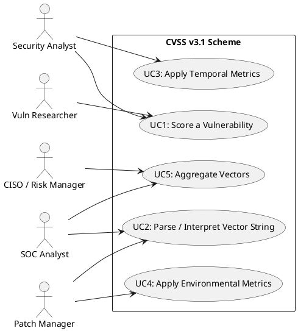
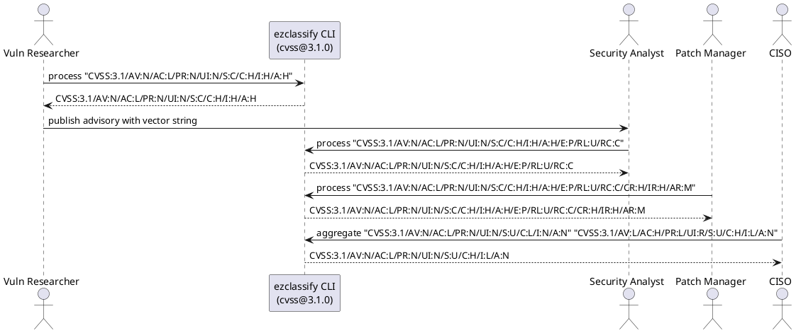

# CVSS v3.1 Actors & Use Cases

## Actors

| Actor                    | Role                                                                                                   | Day-to-Day Context                                                                                        |
| ------------------------ | ------------------------------------------------------------------------------------------------------ | --------------------------------------------------------------------------------------------------------- |
| Security Analyst         | Discovers or triages vulnerabilities, assigns CVSS Base metric values, and produces vector strings     | Works in a vulnerability management team or PSIRT, analyzing advisories and writing security bulletins    |
| Vulnerability Researcher | Identifies new vulnerabilities, determines exploitability characteristics, and publishes CVSS scores   | Performs reverse engineering, fuzzing, and proof-of-concept development; submits findings to CVE programs |
| SOC Analyst              | Consumes CVSS scores from threat feeds to prioritize detection and response activities                 | Monitors SIEM alerts, correlates vulnerability data with asset inventory, and decides on escalation       |
| CISO / Risk Manager      | Uses aggregated CVSS scores to communicate risk posture to leadership and allocate remediation budgets | Reviews dashboards showing vulnerability density by severity, tracks mean-time-to-remediate by CVSS range |
| Patch Manager            | Prioritizes patch deployment schedules based on CVSS scores and environmental adjustments              | Manages patch windows, coordinates with system owners, and validates remediation through rescanning       |

## Use-Case Diagram (Text UML)

## Use Cases

### UC1: Score a Vulnerability

**Actor(s):** Security Analyst, Vulnerability Researcher
**Preconditions:** A vulnerability has been identified and its technical characteristics are understood.
**Flow:**

1. The analyst selects Base metric values: Attack Vector, Attack Complexity, Privileges Required, User Interaction, Scope, and CIA Impact (Confidentiality, Integrity, Availability).
2. The system validates constraints (e.g., only one value per metric).
3. The system renders the CVSS vector string (e.g., "CVSS:3.1/AV:N/AC:L/PR:N/UI:N/S:C/C:H/I:H/A:H").
4. The analyst publishes the vector string in an advisory or vulnerability database entry.
   **Postconditions:** The vulnerability carries a validated CVSS v3.1 Base vector string.

### UC2: Parse / Interpret Vector String

**Actor(s):** SOC Analyst, Patch Manager
**Preconditions:** A CVSS vector string has been received from a feed, advisory, or scanner.
**Flow:**

1. The actor inputs the vector string into the system.
2. The system tokenizes the string on "/" separators and maps each metric:value pair to the corresponding concept.
3. The system displays the human-readable breakdown (e.g., "Attack Vector: Network, Attack Complexity: Low").
4. The actor uses the parsed data to assess urgency and prioritize response.
   **Postconditions:** The actor has a clear understanding of the vulnerability's exploitability and impact characteristics.

### UC3: Apply Temporal Metrics

**Actor(s):** Security Analyst
**Preconditions:** A Base score exists and new information about exploit maturity or remediation is available.
**Flow:**

1. The analyst selects Temporal metrics: Exploit Code Maturity (E), Remediation Level (RL), Report Confidence (RC).
2. The system appends the Temporal metrics to the vector string.
3. The vector records the current threat context (e.g., proof-of-concept exists, no official fix). A separate CVSS calculator can score the completed vector.
   **Postconditions:** The vector string includes Temporal metrics that refine the urgency assessment.

### UC4: Apply Environmental Metrics

**Actor(s):** Patch Manager
**Preconditions:** The organization needs to adjust the CVSS score based on the importance of the affected asset.
**Flow:**

1. The patch manager selects Environmental metrics: Confidentiality Requirement (CR), Integrity Requirement (IR), Availability Requirement (AR).
2. The system validates that only one value per environmental metric is selected.
3. The system renders the full vector string with Environmental adjustments.
   **Postconditions:** The vector records the organization-specific importance of the affected system. Numeric scoring belongs to a separate CVSS calculator.

### UC5: Aggregate Vectors

**Actor(s):** SOC Analyst, CISO / Risk Manager
**Preconditions:** Multiple vulnerabilities have been scored against the same or related assets.
**Flow:**

1. The system collects all CVSS markings for components within a system boundary.
2. Aggregation applies the "max" operator per metric category, producing the worst-case vector.
3. The worst-case vector is displayed on risk dashboards for executive reporting.
   **Postconditions:** Leadership has a single worst-case CVSS representation for the system under review.

## Workflow Sequence (Text UML)

The calls below are EzClassify CLI commands run against this scheme's compiled
JSON (`--scheme dist/schemes/cvss@3.1.0.json`). Each reply is the CLI's actual output. Aggregation keeps the worst value of each metric.

