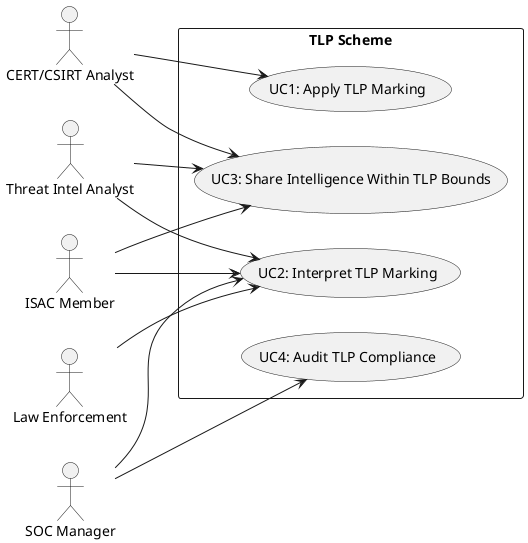
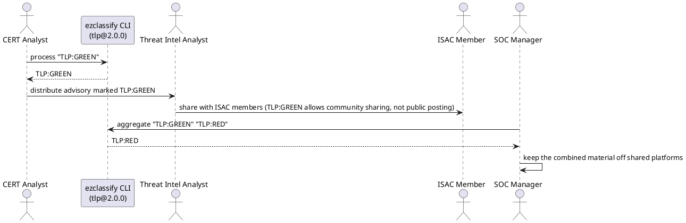

# Traffic Light Protocol (TLP): Actors & Use Cases

## Actors

| Actor | Role | Day-to-Day Context |
|-------|------|--------------------|
| CERT / CSIRT Analyst | Produces and distributes threat intelligence reports, applies TLP markings to control dissemination | Writes advisories, incident notifications, and malware analyses; selects the TLP level based on sensitivity and intended audience |
| Threat Intelligence Analyst | Consumes and correlates threat intelligence from multiple feeds, interprets TLP markings to determine sharing boundaries | Ingests STIX/TAXII feeds, enriches indicators of compromise (IOCs), and redistributes intelligence within TLP constraints |
| ISAC Member | Participates in an Information Sharing and Analysis Center, shares and receives sector-specific intelligence under TLP rules | Attends briefings, submits incident reports, and receives member alerts; must honor the TLP level set by the originator |
| Law Enforcement Cyber Unit | Receives cyber threat intelligence from private sector and government partners, uses TLP to understand disclosure restrictions | Investigates cyber crimes, requests intelligence from ISACs and CERTs, and manages evidence chains with TLP awareness |
| Security Operations Center (SOC) Manager | Manages the flow of TLP-marked intelligence into detection and response workflows | Determines which TLP-marked IOCs can be loaded into SIEM/SOAR platforms, trains analysts on TLP handling rules |

## Use-Case Diagram (Text UML)

## Use Cases

### UC1: Apply TLP Marking
**Actor(s):** CERT / CSIRT Analyst
**Preconditions:** A threat intelligence product (advisory, report, IOC set) has been produced and is ready for distribution.
**Flow:**
1. The analyst assesses the sensitivity of the content and the intended audience.
2. The analyst selects a TLP level: TLP:CLEAR (no restriction), TLP:GREEN (community-wide), TLP:AMBER (organization and clients), TLP:AMBER+STRICT (organization only), or TLP:RED (named recipients only).
3. The system validates that only one TLP level is selected (exclusive constraint).
4. The system renders the TLP marking (e.g., "TLP:AMBER+STRICT").
5. The marking is embedded in the report header and metadata.
**Postconditions:** The intelligence product carries a validated, machine-readable TLP marking.

### UC2: Interpret TLP Marking
**Actor(s):** Threat Intel Analyst, ISAC Member, Law Enforcement Cyber Unit, SOC Manager
**Preconditions:** A TLP-marked intelligence product has been received.
**Flow:**
1. The actor reads the TLP marking from the report header.
2. The system parses the marking and displays the TLP level with its sharing rules.
3. The actor determines what actions are permitted: further distribution scope, public posting, or recipient-only retention.
**Postconditions:** The actor understands the dissemination boundaries and handling obligations.

### UC3: Share Intelligence Within TLP Bounds
**Actor(s):** CERT / CSIRT Analyst, Threat Intel Analyst, ISAC Member
**Preconditions:** TLP-marked intelligence has been received and the actor wants to share it further.
**Flow:**
1. The actor checks the TLP level to determine permitted recipients.
2. For TLP:GREEN, the actor may share within the community but may not post publicly.
3. For TLP:AMBER, the actor may share within their organization and with clients who need to know.
4. For TLP:AMBER+STRICT, sharing is limited to the organization only.
5. For TLP:RED, the actor may not share beyond the named recipients of the original report.
6. The actor distributes the intelligence within the permitted scope, preserving the TLP marking.
**Postconditions:** Intelligence is redistributed in compliance with the originator's TLP designation.

### UC4: Audit TLP Compliance
**Actor(s):** SOC Manager
**Preconditions:** TLP-marked intelligence has been ingested and used in detection/response workflows.
**Flow:**
1. The auditor reviews how TLP-marked IOCs were processed (e.g., loaded into SIEM, shared with partners).
2. The auditor verifies that TLP:RED intelligence was not loaded into shared detection platforms.
3. The auditor checks that TLP:AMBER+STRICT intelligence was not forwarded to external partners.
4. The auditor confirms that TLP:CLEAR intelligence was the only content posted publicly.
5. Non-compliant handling is documented and retraining is recommended.
**Postconditions:** The auditor's findings confirm proper handling or identify violations and corrective actions.

## Workflow Sequence (Text UML)

The calls below are EzClassify CLI commands run against this scheme's compiled
JSON (`--scheme dist/schemes/tlp@2.0.0.json`). Each reply is the CLI's actual output. Aggregation keeps the most restrictive level.

